# AWS Hub-and-Spoke Migration & Multi-Region Disaster Recovery

A hands-on AWS project that migrates an Employee Management application to AWS, places the workload behind a centralized Hub-and-Spoke network, adds edge and network security controls, and validates regional disaster recovery by promoting an Amazon RDS cross-Region read replica and running the application in the DR Region.

> **Project scope:** This repository contains the application files and a set of CloudFormation templates. It does **not** contain every resource configuration used in the deployed environment. Several components were created or completed manually in the AWS Console/CLI. The sections below distinguish repository-managed infrastructure from manually configured resources so the repository is not mistaken for a complete one-click deployment package.

## Project at a glance

| Item                     | Value                                                                                  |
| ------------------------ | -------------------------------------------------------------------------------------- |
| Cloud provider           | Amazon Web Services (AWS)                                                              |
| Primary Region           | US East (Ohio) — `us-east-2`                                                           |
| Disaster Recovery Region | Canada (Central) — `ca-central-1`                                                      |
| Application              | Employee Management System                                                             |
| Application stack        | Node.js, Express, EJS, MySQL                                                           |
| Migration service        | AWS Application Migration Service (MGN)                                                |
| Infrastructure as Code   | AWS CloudFormation for selected network, load-balancing, and compute components        |
| DR approach              | Cross-Region Amazon RDS MySQL read replica, manual promotion, and application failover |
| Edge protection          | Amazon CloudFront integrated with AWS WAF                                              |
| Threat response          | Amazon GuardDuty → Amazon EventBridge → AWS Lambda                                     |

## What the project demonstrates

- Migrating a server-based application to AWS using AWS MGN.
- Separating the application tier from its database and connecting the application to Amazon RDS for MySQL.
- Building a Hub-and-Spoke network in the primary Region with AWS Transit Gateway.
- Inspecting network traffic with AWS Network Firewall.
- Distributing application traffic through an internet-facing Application Load Balancer and an internal Network Load Balancer.
- Running application instances through an EC2 Auto Scaling Group.
- Protecting the public application endpoint with CloudFront and AWS WAF managed rules.
- Replicating the database to a second Region, promoting the read replica, and validating that the application can run in the DR Region.
- Automating a response to selected GuardDuty findings with EventBridge and Lambda.

## Architecture

### Full infrastructure architecture diagram

The diagram below provides a consolidated visual overview of the primary Region, DR Region, VPCs, Availability Zones, subnet tiers, load balancers, compute layer, database replication, migration workflow, and security automation.

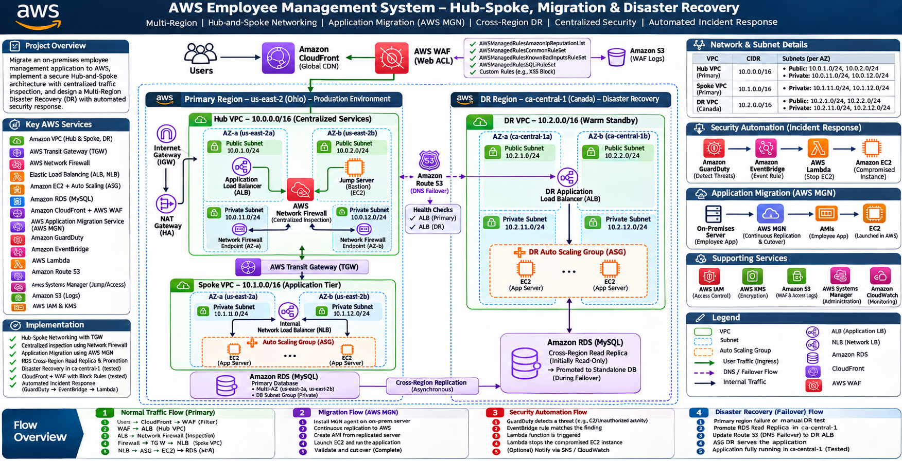

> **Diagram accuracy note:** This is an architectural overview, not a deployable network plan. The subnet CIDRs, AZ placement, and supporting-service icons shown in the illustration are visual references and must be checked against the actual deployed VPCs and AWS account before being treated as authoritative. In particular, the Route 53/failover path should not be interpreted as proof of automated DNS failover; the tested DR process documented below involved manually promoting the RDS read replica and switching the DR application to the promoted database. Only resources and behaviors confirmed in the project documentation should be considered implemented.

### Primary Region — `us-east-2`

The primary environment is split into two VPCs:

- **Hub VPC** — centralized ingress, administration, NAT egress, and network inspection components.
  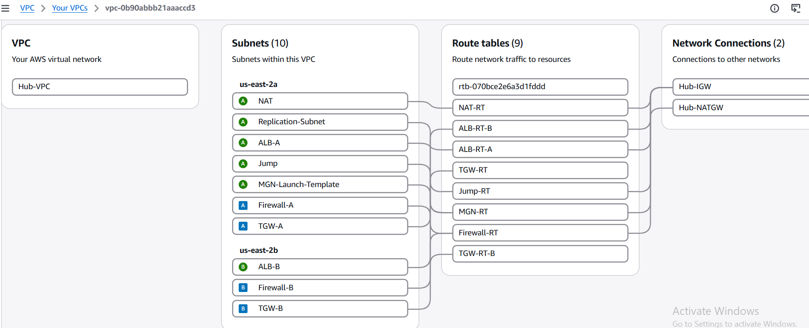
- **Spoke VPC** — application workload and internal load balancing.
  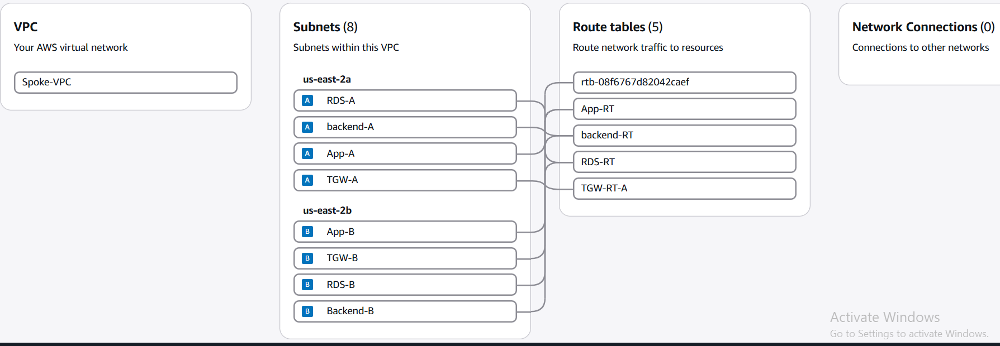

The primary application traffic path is conceptually:

```text
Internet users
    |
    v
Amazon CloudFront
    |
    v
AWS WAF (Web ACL associated with CloudFront)
    |
    v
Internet-facing Application Load Balancer (Hub VPC)
    |
    v
AWS Network Firewall inspection
    |
    v
AWS Transit Gateway
    |
    v
Internal Network Load Balancer (Spoke VPC)
    |
    v
EC2 instances in an Auto Scaling Group
    |
    v
Amazon RDS for MySQL (primary database)
```

### Primary Network Infrastructure Evidence

- Transit Gateway Attachments
  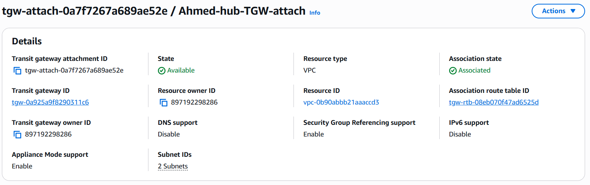

- Network Firewall Endpoints
  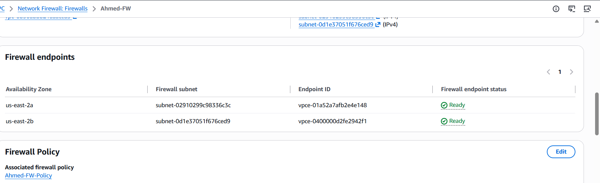

- Firewall Route Table
  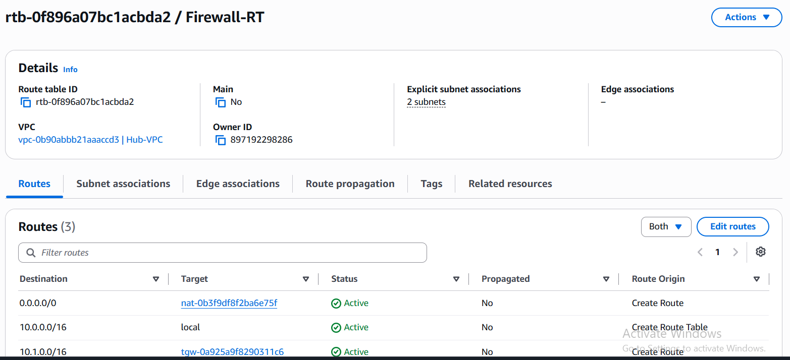

- ALB Routing
  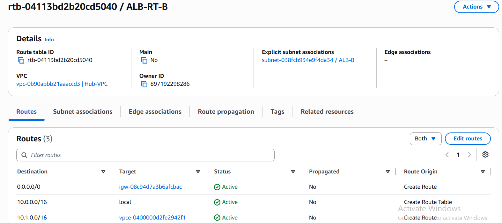

- Firewall Policy
  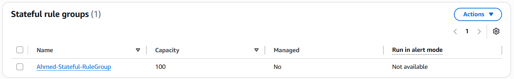

### Load Balancing and Compute Evidence

- Internal NLB
  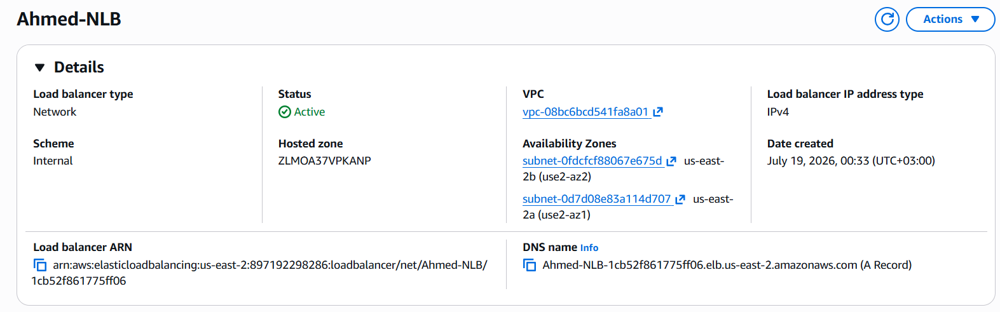

- Primary Auto Scaling Group
  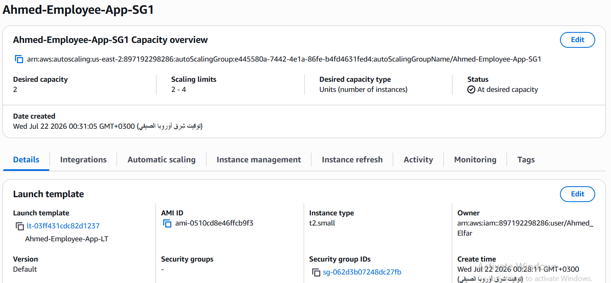

- Custom AMI
  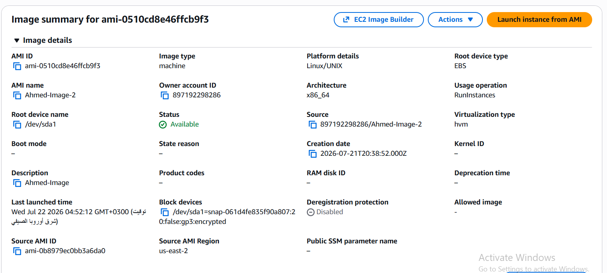

The exact route-table entries and firewall endpoint routing are environment-specific. Some of these associations and target registrations were completed manually after the CloudFormation stacks were deployed.

### Disaster Recovery Region — `ca-central-1`

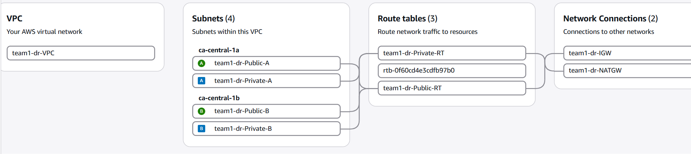
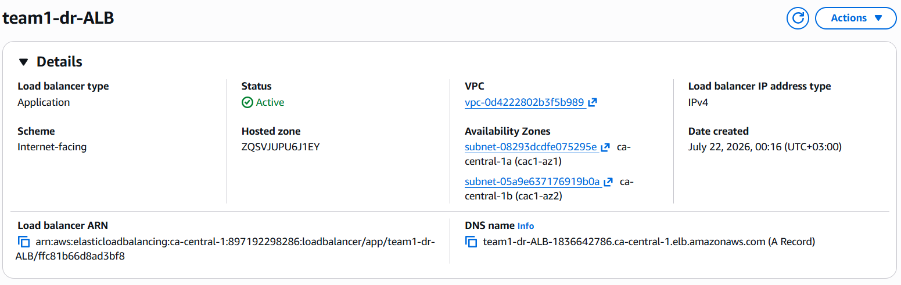

The DR environment includes a separate VPC and application-side resources, including an Application Load Balancer and Auto Scaling Group. The database is replicated from the primary Region using an Amazon RDS cross-Region read replica.

The DR exercise was performed and validated:

1. The read replica in `ca-central-1` was promoted to a standalone writable database.
2. The application environment in the DR Region was configured to use the promoted database.
3. The application was started and tested in `ca-central-1` after failover.

This is a **manual recovery workflow** as documented here. Do not interpret it as automatic regional failover unless automated DNS/application cutover has separately been implemented and tested.

### Security automation flow

```text
Amazon GuardDuty finding
          |
          v
Amazon EventBridge rule
          |
          v
AWS Lambda function
          |
          v
EC2 StopInstances API action
```

The GuardDuty → EventBridge → Lambda response was tested successfully. The Lambda function in the collected project evidence is named `StopCompromisedEC2`. Its action is to stop the EC2 instance identified in a matching finding. Stopping an instance is an automated containment action; it is not equivalent to full forensic isolation or remediation.

## Main AWS components

| Area                   | Components                                                               | Purpose                                                   |
| ---------------------- | ------------------------------------------------------------------------ | --------------------------------------------------------- |
| Networking             | Hub VPC, Spoke VPC, subnets, route tables, Internet Gateway, NAT Gateway | Network segmentation and connectivity                     |
| Inter-VPC connectivity | Transit Gateway, VPC attachments, TGW route table and routes             | Connect Hub and Spoke VPCs                                |
| Traffic inspection     | AWS Network Firewall, firewall policy and rule group                     | Inspect and control routed traffic                        |
| Ingress                | Application Load Balancer                                                | Public application entry point in the Hub VPC             |
| Internal distribution  | Network Load Balancer                                                    | Forward traffic to application instances in the Spoke VPC |
| Compute                | EC2, Launch Template, Auto Scaling Group, AMI                            | Run and scale the application tier                        |
| Database               | Amazon RDS for MySQL                                                     | Managed application database                              |
| Migration              | AWS Application Migration Service (MGN)                                  | Replicate and cut over the source server                  |
| Edge                   | CloudFront and AWS WAF Web ACL                                           | CDN delivery and web request filtering                    |
| Threat detection       | Amazon GuardDuty                                                         | Detect suspicious activity and generate findings          |
| Event automation       | Amazon EventBridge and AWS Lambda                                        | Trigger the tested EC2 stop response                      |
| DR                     | DR VPC, DR ALB, DR Auto Scaling Group, RDS cross-Region read replica     | Recover the application in another Region                 |

## Repository contents

The current repository snapshot contains these principal files:

| File                               | Role                                                                                    |
| ---------------------------------- | --------------------------------------------------------------------------------------- |
| `hub-vpc-us-east-2.yml`            | Hub VPC, subnets, route-table resources, NAT Gateway, and Jump Server resources         |
| `spoke-vpc-us-east-2.yml`          | Spoke VPC, application subnets, and route-table resources                               |
| `TGW.yml`                          | Transit Gateway, attachments, route-table associations/propagations, and routes         |
| `firewall.yml`                     | Network Firewall rule group, policy, and firewall                                       |
| `NLB.yml`                          | Internal Network Load Balancer and target group                                         |
| `ALB.yml`                          | Application Load Balancer, listener, target group, and related security group resources |
| `LT.yml`                           | EC2 Launch Template and application instance security group                             |
| `asg-1.yml`                        | Auto Scaling Group and scaling policy                                                   |
| `cloud-front&waf.yml`              | CloudFront distribution and WAF Web ACL definition                                      |
| `app.js`, `db.js`, `employee.js`   | Node.js application and database/route code (see repository structure note below)       |
| `index.ejs`, `add.ejs`             | EJS application views                                                                   |
| `assets/architecture-overview.png` | Full infrastructure architecture diagram                                                |

### Important repository limitations

The uploaded repository snapshot is not yet a complete, reproducible application package:

- `app.js` imports `./routes/employee`, but the supplied `employee.js` is at the repository root. It needs to be placed at `routes/employee.js` or the import needs to be changed.
- `app.js` serves static files from `public/`, but that directory is not included in the supplied ZIP.
- `package.json` is not included, so dependencies and start scripts are not pinned/documented in the repository snapshot.
- A safe `.env.example` should be provided instead of committing `.env`.
- The DR Region resources, RDS configuration/replication, MGN configuration, GuardDuty/EventBridge/Lambda configuration, and some manual network integrations are not represented by the supplied CloudFormation templates.

Consequently, this repository documents the project and provides selected IaC templates; it is not currently a complete end-to-end deployment bundle.

## Infrastructure as Code and manual configuration

### CloudFormation templates included

The following templates are present in this repository:

| Suggested order | Template                  | Main responsibility                                                                                 |
| --------------: | ------------------------- | --------------------------------------------------------------------------------------------------- |
|               1 | `hub-vpc-us-east-2.yml`   | Create the primary Hub VPC foundation                                                               |
|               2 | `spoke-vpc-us-east-2.yml` | Create the primary Spoke VPC foundation                                                             |
|               3 | `TGW.yml`                 | Create TGW connectivity between the VPCs                                                            |
|               4 | `firewall.yml`            | Define Network Firewall resources                                                                   |
|               5 | `NLB.yml`                 | Create the internal NLB in the Spoke VPC                                                            |
|               6 | `ALB.yml`                 | Create the ingress ALB in the Hub VPC                                                               |
|               7 | `LT.yml` and `asg-1.yml`  | Define the application Launch Template and Auto Scaling Group                                       |
|               8 | `cloud-front&waf.yml`     | Define CloudFront and WAF resources (CloudFront-scope WAF resources must be created in `us-east-1`) |

### Resources configured outside the supplied templates

The deployed project also used resources and configuration that are not fully represented in the supplied YAML files. Based on the implementation review and the user's confirmation, these include:

- AWS Application Migration Service (MGN) source replication, test/cutover workflow, and migrated server/AMI preparation.
- Amazon RDS for MySQL and the cross-Region read replica in `ca-central-1`.
- DR Region VPC/application infrastructure, including the DR load balancer and Auto Scaling Group.
- GuardDuty detector/configuration, EventBridge rule, and Lambda function used by the tested incident-response workflow.
- CloudFront distribution and its associated WAF Web ACL/rules, where the deployed configuration was completed outside the supplied templates or required manual completion.
- Network Firewall endpoint route-table associations and ALB target-group registration for the NLB endpoint IPs, as applicable to the deployed environment.

The precise creation method can differ by resource. The important distinction is that **absence from this repository's CloudFormation files does not mean the resource was absent from the deployed project**.

## Application

The application is an Employee Management System built with Node.js, Express, EJS, and MySQL. The available source files show:

- `app.js` initializes Express, configures URL-encoded/JSON request parsing, serves a `public` directory, configures EJS, and mounts employee routes.
- `db.js` reads database connection values from environment variables and creates a MySQL connection.
- `employee.js` implements routes to list employees, render the add form, and insert a new employee using parameterized SQL values.
- `index.ejs` and `add.ejs` provide the application views.

### Required environment variables

Create a local `.env` file from a safe template. Do not commit credentials.

```dotenv
PORT=3000
DB_HOST=<RDS_ENDPOINT_OR_LOCAL_DB_HOST>
DB_USER=<DATABASE_USERNAME>
DB_PASSWORD=<DATABASE_PASSWORD>
DB_NAME=company
```

### Database schema

The application expects a MySQL database named `company` with an `employees` table containing at least the columns used by the application: `id`, `name`, `department`, and `salary`.

Example schema (use a dedicated least-privilege database user and a strong secret in real deployments):

```sql
CREATE DATABASE company;

USE company;

CREATE TABLE employees (
    id INT AUTO_INCREMENT PRIMARY KEY,
    name VARCHAR(100) NOT NULL,
    department VARCHAR(100) NOT NULL,
    salary DECIMAL(10,2) NOT NULL,
    created_at TIMESTAMP DEFAULT CURRENT_TIMESTAMP
);
```

### Application packaging required before a fresh deployment

Before treating the application as independently deployable, add and verify:

- `package.json` with pinned dependencies and start script.
- `routes/employee.js` (or update the import path in `app.js`).
- The `public/` directory if static assets are required.
- `.env.example` containing placeholders only.
- A documented process-manager/service configuration if the app is expected to start automatically after reboot.

## Migration workflow — AWS MGN

The application server was migrated using AWS Application Migration Service:

1. Install/configure the AWS Replication Agent on the source server.
2. Replicate source disks to the MGN staging area in the target Region.
3. Launch a test instance and validate the operating system and application.
4. Perform final synchronization and cutover.
5. Prepare an AMI from the migrated application server for subsequent EC2 deployment through a Launch Template/Auto Scaling Group.

The project evidence includes a completed cutover state and a migrated application image. MGN configuration is not included in the CloudFormation templates in this repository.

- MGN Cutover Completed
  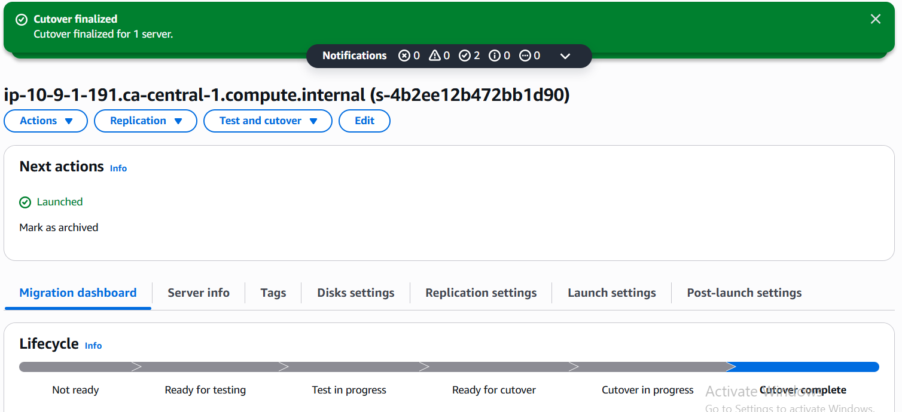

- Migrated Application AMI
  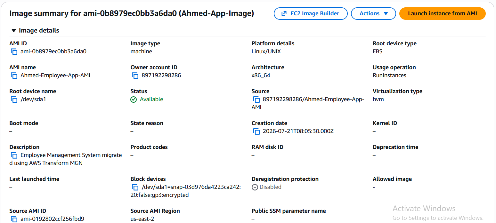

## Database and regional disaster recovery

The primary database runs in `us-east-2`, with a cross-Region MySQL read replica in `ca-central-1`.

The tested recovery sequence was:

1. Promote the cross-Region read replica in `ca-central-1` to a standalone writable DB instance.
2. Update/reconfigure the DR application to connect to the promoted database endpoint.
3. Run and validate the Employee Management application in `ca-central-1`.

- Primary RDS
  

- Promote Read Replica
  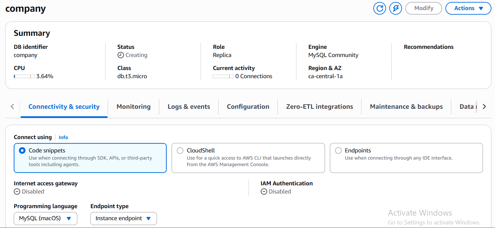

**Recovery characteristics:**

- Replication is asynchronous database replication; it is not block-level replication.
- Promotion and application cutover were manually initiated in the tested workflow.
- No numeric RTO or RPO is claimed in this README because measured values have not yet been supplied.
- A successful DR test does not by itself establish automatic DNS failover or a fully automated regional recovery process.

## Edge security — CloudFront and AWS WAF

The application was exposed through Amazon CloudFront, with an AWS WAF Web ACL associated with the distribution. The WAF protection included the following AWS managed rule groups in the project configuration:

- `AWSManagedRulesAmazonIpReputationList`
- `AWSManagedRulesCommonRuleSet`
- `AWSManagedRulesKnownBadInputsRuleSet`
- `AWSManagedRulesSQLiRuleSet`

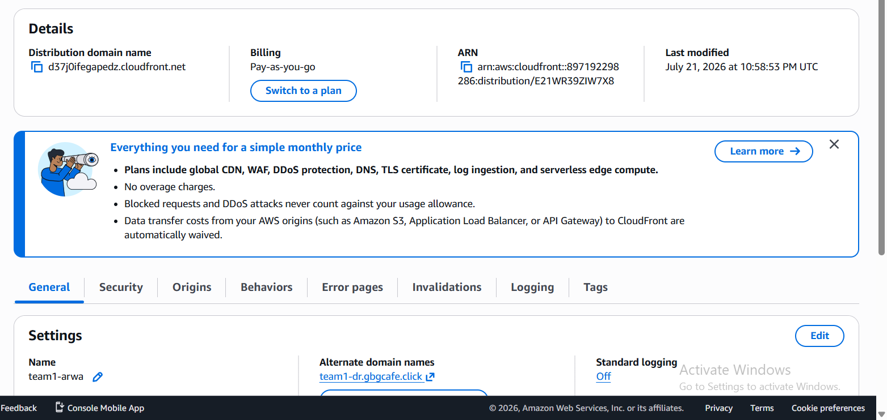

The user confirmed that the Web ACL was associated with CloudFront and that block rules were tested. The repository includes a CloudFormation definition for the edge resources, but the supplied deployment evidence also indicates that the initial CloudFormation stack attempt did not complete successfully; the final working configuration therefore should not be assumed to have been created solely by that stack.

## Automated threat response — GuardDuty, EventBridge, and Lambda

The user confirmed that the incident-response workflow was tested successfully:

1. GuardDuty generates a finding for suspicious activity.
2. An EventBridge rule matches the relevant finding criteria.
3. EventBridge invokes the Lambda function.
4. The Lambda extracts the affected EC2 instance identifier and calls the EC2 `StopInstances` API.

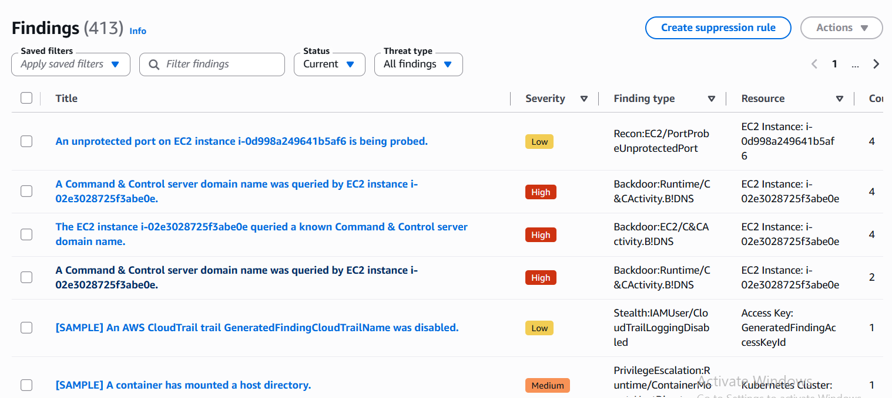
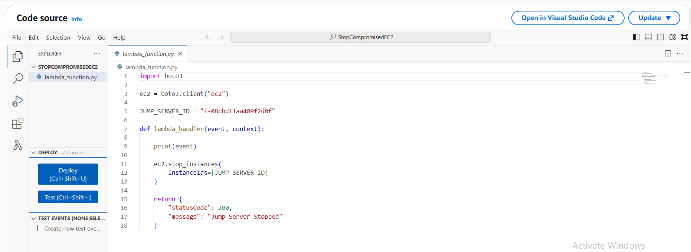

This workflow is designed as a basic automated containment demonstration. In a production environment, the finding filters, permissions, notification, evidence preservation, and isolation/remediation process should be reviewed carefully before enabling automatic instance shutdown.

## Validation performed

The following outcomes have been confirmed by the project owner:

| Area            | Validation                                                    | Result    |
| --------------- | ------------------------------------------------------------- | --------- |
| MGN migration   | Source workload migration/cutover completed                   | Confirmed |
| Database DR     | Cross-Region read replica promoted to standalone writable DB  | Confirmed |
| Application DR  | Application ran successfully in `ca-central-1` after failover | Confirmed |
| Edge security   | CloudFront associated with WAF Web ACL; block rules tested    | Confirmed |
| Threat response | GuardDuty → EventBridge → Lambda EC2 stop workflow tested     | Confirmed |

Other tests such as exact measured RTO/RPO, full AZ-failure testing, sustained load testing, and repeatable clean-account deployment are not claimed here unless separately measured and documented.

## Author

**Ahmed Elfar**

- GitHub: [ahmedelfar25](https://github.com/ahmedelfar25)
- LinkedIn: [Ahmed Elfar](https://www.linkedin.com/in/ahmed-elfar-6672112a4)
